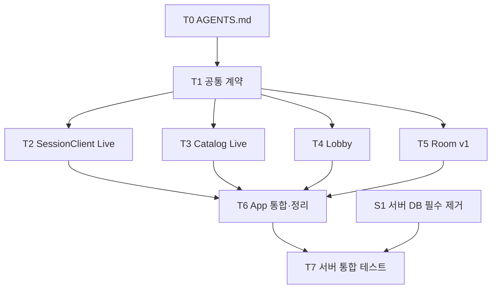

# iOS 랜덤 매칭 작업 분해

> **이 문서의 목표:** 누가 어떤 순서로 만들지를, 여러 에이전트가 나눠 맡아도 겹치거나 빠지지 않게 정한다.
>
> **작업 크기 기준:** 작업 하나는 PR 하나를 한 번에 검토할 수 있는 크기로 자른다.
>
> **이 문서에 두지 않는 것:** 무엇을 왜 만드는지는 requirements.md, 안쪽 구조는 design.md, 바깥 형식은 같은 폴더의 `protocol.md`(서버 v1 복사본). 모든 기능에 공통인 규칙(작업 공간, 작업 중 행동, 입력·보고 형식, 브랜치 절차)은 AGENTS.md.

- 상태: 확정
- 버전: v1.0
- 기준 문서 버전: requirements v1.0 / design v1.0 / protocol v1 (복사본, SOURCE.md)
- 작성일: 2026-11-25

---

## 1. 작업 목록

| ID | 맡는 범위 | 참조할 문서 섹션 | 이슈 |
|---|---|---|---|
| T0 | iOS 저장소 AGENTS.md / CLAUDE.md를 develop에 추가 | AGENTS.md 초안 | 없음 (커밋 f79f759) |
| T1 | 공통 계약: Models v1 타입과 `MessageCodec`, `SessionClient`·`CatalogClient`·`CategoryPreferenceClient` 인터페이스와 Test 구현, 이번 기능의 모든 신규 Tuist 타깃 선언, `fixtures/`를 `ModelsTests` 리소스로 연결한 코덱 테스트, CI 테스트 단계 | requirements 3, 7(REQ-FAIL-04), 9(EDGE-15, 16), 12(DONE-01, 02, 14) / design 2, 3, 4, 6, 7 | [#29](https://github.com/temp-pj/Earie-iOS/issues/29) |
| T2 | `ClientSessionLive`: v1 URL, 연결마다 새 스트림, `SessionEvent` 변환, 디코딩 실패 폐기, 송신 | requirements 7(REQ-MATCH-02, REQ-FAIL-03, 04) / design 7, 9, 11, 13 | [#30](https://github.com/temp-pj/Earie-iOS/issues/30) |
| T3 | `ClientCatalogLive`와 앱 번들 카탈로그(`fixtures/catalog-projection.json`을 그대로 복사) | requirements 7(REQ-CAT-06~08) / design 6, 7, 13 | [#31](https://github.com/temp-pj/Earie-iOS/issues/31) |
| T4 | `FeatureLobby`: 조건 선택, 후보 활성 판정, 매칭 대기, 취소, 저장·복원 | requirements 7(REQ-CAT, REQ-MATCH-01·03~06, REQ-CANCEL-01·03), 8, 9, 11 / design 5, 6, 7, 8 | [#32](https://github.com/temp-pj/Earie-iOS/issues/32) |
| T5 | `FeatureRoom` v1: WELCOME으로 방 생성, 방 이벤트, 시작, 나가기, 게임 연결, GAME_ABORTED, 결과, delegate 송신 | requirements 7(REQ-ROOM, REQ-GAME), 8, 9 / design 5, 6, 7, 8, 12 | [#33](https://github.com/temp-pj/Earie-iOS/issues/33) |
| T6 | App 통합: `AppFeature` 연결 수명·거르기·라우팅·알럿, `RootView`, live 주입, 구 모듈과 구 타입 삭제 | requirements 7(REQ-MATCH-02·07, REQ-CANCEL-02·04, REQ-FAIL, REQ-FILTER, REQ-GAME-07), 8, 9 / design 1, 5, 8, 9, 10, 11, 12 | [#34](https://github.com/temp-pj/Earie-iOS/issues/34) |
| T7 | 로컬 v1 서버에 실제로 붙는 통합 테스트와 CI 연결 (PR에서만 실행) | requirements 12(DONE-13) / design 13 | [#35](https://github.com/temp-pj/Earie-iOS/issues/35) |
| S1 | (서버 저장소 Earie-ws) 서버 시작 시 DB 연결 필수 조건 제거 | 이 문서 11번 | [Earie-ws#44](https://github.com/temp-pj/Earie-ws/issues/44) |

- 근거: T1에서 공유 타입, 인터페이스, Tuist 타깃을 먼저 확정해야 T2~T5가 서로의 파일을 건드리지 않고 병렬로 돈다. Project.swift는 여러 작업이 동시에 고치면 반드시 충돌하는 파일이라 T1(추가)과 T6(삭제)만 수정한다.

## 2. 의존성

| 작업 | 먼저 끝나야 하는 작업 | 병렬로 같이 할 수 있는 작업 |
|---|---|---|
| T0 | 없음 | - |
| T1 | T0 | - |
| T2 | T1 | T3, T4, T5 |
| T3 | T1 | T2, T4, T5 |
| T4 | T1 | T2, T3, T5 |
| T5 | T1 | T2, T3, T4 |
| T6 | T2, T3, T4, T5 | - |
| T7 | T6, S1 | - |
| S1 | 없음 (iOS 작업과 독립) | T0~T6 전부 |

## 3. 공유 계약 선행 작업

- 선행 작업: T1
- 그 작업이 확정하는 것:
  - `Models`: `MatchCategory`, `CatalogProjection`, `CatalogGenre`, `PoolProjection`, `ClientMessage`, `ServerMessage`와 v1 payload DTO, `RoomServerEvent`, `MessageCodec`
  - `ClientSession` Interface(`SessionClient`, `SessionEvent`, `SessionCloseReason`)와 `ClientSessionTest`
  - `ClientCatalog` Interface와 `ClientCatalogTest`
  - Project.swift: 신규 타깃 `ClientSession`, `ClientSessionLive`, `ClientSessionTest`, `ClientCatalog`, `ClientCatalogLive`, `ClientCatalogTest`, `ModelsTests`, `FeatureLobbyTests`, `M_GAMETests`, `SessionIntegrationTests`와 각 placeholder 소스. `FeatureLobby`, `FeatureRoom`, `M_GAME`에 새 의존성 추가 (기존 의존성은 지우지 않는다)
  - fastlane `test` lane과 CI 테스트 단계
- T1은 구 타입과 구 모듈을 지우지 않는다. 앱은 T1 이후에도 구 경로로 빌드되어야 한다.
- 병렬 작업 중 공유 계약을 바꿔야 할 때: 그 작업을 멈추고 필요한 변경과 영향을 보고한다. 변경은 T1 후속 PR로 먼저 병합한 뒤 각 작업이 반영한다. 각 작업이 공유 타입을 따로 고치지 않는다.

## 4. 파일 소유권

| 작업 | 수정할 수 있는 파일 | 수정하면 안 되는 파일 |
|---|---|---|
| T0 | `AGENTS.md`, `CLAUDE.md` | 그 외 전부 |
| T1 | `Models/**`, `Clients/SessionClient/Interface/**`, `Clients/SessionClient/Test/**`, `Clients/CatalogClient/Interface/**`, `Clients/CatalogClient/Test/**`, 신규 타깃 placeholder 소스, `Project.swift`, `fastlane/Fastfile`, `.github/workflows/ci.yml` | `Features/**`, `M_GAME/**`, 기존 `Clients/**` |
| T2 | `Clients/SessionClient/Live/**`, `Clients/SessionClient/Tests/**` | `Models/**`, Interface, `Project.swift` |
| T3 | `Clients/CatalogClient/Live/**`, `Clients/CatalogClient/Tests/**`, `M_GAME/Resources/catalog-projection.json` | `Models/**`, Interface, `M_GAME/Sources/**`, `Project.swift` |
| T4 | `Features/Lobby/**` | `Models/**`, `Clients/**`, `Project.swift` |
| T5 | `Features/Room/**`. 빌드를 유지하기 위한 최소 수정에 한해 `M_GAME/Sources/AppFeature.swift`, `M_GAME/Sources/ContentView.swift` | `Models/**`, `Clients/**`, `Project.swift` |
| T6 | `M_GAME/**`(Resources의 카탈로그 제외), `Project.swift`(구 타깃과 낡은 의존성 삭제만), 삭제: `Clients/RoomSessionClient/**`, `Clients/RoomClient/**`, 구 Models 타입 | `Features/**`, 신규 `Clients/**` |
| T7 | `IntegrationTests/**`, `fastlane/Fastfile`, `.github/workflows/ci.yml` | 그 외 전부 |

- T5의 `M_GAME/Sources` 수정은 T2~T4와 겹치지 않고 T6은 T5 병합 후에 시작하므로 충돌하지 않는다. 그 수정은 T6에서 전부 다시 쓰인다.
- 구 Models 타입(구 `Category`, `StartGamePayload`, 구 payload DTO, 구 `RoomEvent`, `ServerConnectionState`, `DisconnectReason`, `RoomConnectionInfo`, `RoomCloseReason`, `RoomSessionState`, `Room`, `CreateRoomRequest`, `UpdateRoomRequest`)의 삭제는 T6이 한다. 삭제 기준은 design 1번 "바꿀 것"이다.

## 5. 작업이 넘겨줄 것

| 작업 | 넘겨줄 것 | 받는 작업 | 넘기는 방법 |
|---|---|---|---|
| T1 | 확정 타입·인터페이스 목록, 테스트 실행 명령, fixture 원본 SHA | T2~T7 | PR 본문에 "확정 API" 표와 `bundle exec fastlane test` 결과 기록 |
| T2 | `SessionClient.live`, `SessionClient.live(host:)` | T6, T7 | PR 본문 |
| T3 | `CatalogClient.live`, `CategoryPreferenceClient.live`, 번들 파일 경로 | T6 | PR 본문 |
| T4 | `LobbyReducer`, `LobbyView`, delegate 목록 | T6 | PR 본문 |
| T5 | `RoomReducer.State(welcome:)`, `RoomReducer`·`RoomView`, delegate 목록, 효과 취소 ID | T6 | PR 본문 |
| T6 | 최종 앱 조립, 로컬 서버 실행 방법 | T7 | PR 본문과 AGENTS.md 갱신 |

## 6. 합치는 순서

- 작업 결과를 합칠 브랜치: iOS `feature/random-matchmaking` (T0 병합 후 develop에서 생성)
- 순서: T1 → T2, T3, T4, T5 (병합 순서 무관) → T6 → T7
- 최종적으로 합칠 곳: develop. T7 통과와 사람의 시뮬레이터 확인 후 최종 PR
- T0만 develop에 직접 PR한다.
- S1은 서버 저장소의 별도 작업이다. 서버 AGENTS.md를 따르고, 서버 develop에 병합된 SHA를 T7이 고정해서 쓴다.

- 근거: AGENTS.md는 기능과 무관한 공통 규칙이라, 기능 브랜치를 만들기 전에 develop에 있어야 모든 worktree가 같은 규칙을 읽는다.

## 7. 요구사항 배정 확인

| 요구사항 / 완료 조건 ID | 맡는 작업 |
|---|---|
| REQ-CAT-01~05 | T4 |
| REQ-CAT-06 | T3 (읽기 실패), T4 (표시와 비활성) |
| REQ-CAT-07, 08 | T3 (저장소), T4 (복원 판정) |
| REQ-MATCH-01, 03~06 | T4 |
| REQ-MATCH-02 | T2 (연결 구현), T6 (재사용 판단) |
| REQ-MATCH-07 | T5 (방 상태 생성), T6 (전환) |
| REQ-CANCEL-01, 03 | T4 |
| REQ-CANCEL-02, 04 | T6 |
| REQ-FAIL-01, 02 | T6 |
| REQ-FAIL-03 | T2, T6 |
| REQ-FAIL-04 | T1 (코덱), T2 (폐기) |
| REQ-ROOM-01~07 | T5 (화면과 상태), T6 (ROOM_LEFT·강퇴 전환) |
| REQ-GAME-01~06 | T5 |
| REQ-GAME-07 | T6 |
| REQ-FILTER-01~03 | T6 |
| SCOPE-09 | T6 |
| DONE-01, 02, 14 | T1 |
| DONE-03, 05 | T3, T4 |
| DONE-04, 06(로비 쪽), 07(로비 쪽) | T4 |
| DONE-06(연결 쪽), 07(늦은 응답), 08, 12 | T6 |
| DONE-09, 10(방 쪽), 11 | T5 |
| DONE-10(전환) | T6 |
| DONE-13 | T7 |

## 8. 작업별 검증

모든 작업 공통: `swiftlint lint --strict`, `tuist install && tuist generate --no-open`, `bundle exec fastlane test`. 아래는 각 작업이 추가로 갖춰야 할 테스트다.

| 작업 | 검증 내용 | 실행 명령 |
|---|---|---|
| T0 | 문서만 변경 | 없음 |
| T1 | `fixtures/messages-valid.json` 전체(서버 방향 디코딩, 클라이언트 방향 디코딩 후 재인코딩·canonical 비교), 잘못된 서버 방향 메시지 전체 거부, 송신 ID 소문자, `MatchCategory` JSON 키 | `bundle exec fastlane test` |
| T2 | 테스트용 `WebSocketClient`로: URL에 `protocolVersion=1`이 있고 `room`이 없음, 연결마다 새 스트림, 이전 연결 이벤트가 새 스트림에 안 섞임, 디코딩 실패 시 폐기 후 다음 메시지 정상 전달 | 동일 |
| T3 | 번들 파일 읽기, 파일 없음·형식 오류 시 throw, 저장·읽기 | 동일 |
| T4 | TestStore: 기본값, 후보 활성 판정(REQ-CAT-04, test-v1에서 두 목표 조합 도달 포함), 매칭 버튼 비활성, 이용 불가 표시, 매칭 탭 즉시 `.matching`과 delegate와 조합 저장, 연타 시 delegate 1회, 취소 즉시 `.selecting`과 delegate, 취소 후에도 저장값 유지, 복원·기본값 복귀 | 동일 |
| T5 | TestStore: WELCOME으로 만든 상태, 참가자·방장 갱신, 시작 버튼 판정, 나가기와 나가는 중, 곡 준비 성공·실패, 게임 한 사이클, GAME_OVER(승자 없음 포함), GAME_ABORTED 두 사유와 문구, 음악 정지, ROOM_COMMAND_FAILED 코드별 알럿, 게임 중 나가기 확인창(확인·취소), 방 대기·결과의 나가기는 확인창 없음 | 동일 |
| T6 | TestStore(`ClientSessionTest`): 9번 표의 모든 칸, 세대가 다른 이벤트 무시, 늦은 WELCOME·이전 방 메시지 무시, 연결 중 취소, 취소 후 재매칭, MATCH_FAILED 코드별 알럿 문구, 끊김 알럿과 조건 선택 화면에서의 무알럿, 연결 시도 10초 초과, 강퇴 알럿, ROOM_LEFT·강퇴 전환, 로비 전환 시 음악 정지와 효과 취소, Feature 소스에 `import ClientSession` 없음 | 동일, `grep -r "import ClientSession" Features` 결과 없음 |
| T7 | 아래 9번 | `bundle exec fastlane integration` |

- 테스트는 시간 대기에 `TestClock`을 쓰고 실제 sleep에 기대지 않는다.
- 환경 문제로 실행하지 못한 검증은 통과로 기록하지 않는다.

## 9. 마지막 통합 검증

- 검증하는 시나리오 (`SessionClient.live(host:)`로 실제 연결 여러 개):
  - 연결 2개가 같은 조합으로 매칭 → 양쪽 WELCOME, 같은 roomID, players 순서 일치
  - 조건이 맞지 않는 2개 → 둘 다 MATCH_WAITING 후 배정 없음
  - 매칭 대기 중 취소 → MATCH_CANCELLED, 같은 연결로 새 requestID 매칭 성공
  - 방장 START_GAME → GAME_STARTED, PRELOAD_SONG 수신 (곡 준비는 하지 않음) → 약 30초 뒤 GAME_ABORTED(INTERNAL_ERROR)
  - 1명 남김 → 시작 시 ROOM_COMMAND_FAILED(NOT_ENOUGH_PLAYERS)
  - LEAVE_ROOM → ROOM_LEFT, 같은 연결로 재매칭 성공
  - 잘못된 카탈로그 버전으로 MATCH_REQUEST → MATCH_FAILED(INVALID_CRITERIA)
- 실행 환경: macOS, iOS 시뮬레이터, 로컬 Earie-ws 서버(`feature/random-matchmaking` 고정 SHA)를 `CATALOG_PATH`·`SONG_MANIFEST_PATH`에 fixture를 지정해 실행
- 실행 명령: `bundle exec fastlane integration` (T7이 서버 기동, 대기, 테스트, 종료를 묶는다)
- CI: 통합 테스트는 `pull_request` 이벤트에서만 돌린다. push마다 도는 CI는 린트, 빌드, 단위 테스트까지만 한다.
  - 근거: macOS 러너에서 Go 설치와 서버 기동이 매번 몇 분씩 붙는다. 두 저장소가 public이라 표준 러너 비용은 없지만 대기 시간이 늘어난다.
- 보장 범위: 통합 테스트는 전송 계층, 코덱, 서버 계약을 검증한다. App의 거르기와 화면 전환은 T6의 TestStore 테스트가 검증한다.
- 사람 확인: 마지막에 시뮬레이터 두 대로 매칭, 방, 시작, 결과, 나가기 화면을 한 번 본다.
- 이번에 검증하지 않는 것: 실제 음원 재생, 실제 카탈로그, 디자인

## 10. 이 기능에서만 다른 규칙

- Earie-ws 저장소는 읽기만 한다 (S1 제외).
- `protocol.md`, `fixtures/`, `SOURCE.md`는 서버 계약의 읽기 전용 사본이다. 어떤 작업도 고치지 않는다. 계약과 맞지 않는 부분을 발견하면 멈추고 보고한다.
- `ModelsTests`는 `docs/specs/random-matchmaking/fixtures/`를 테스트 리소스로 직접 참조한다. 다른 곳에 다시 복사하지 않는다. 앱 번들의 `catalog-projection.json`만 예외로 복사한다.
- requirements나 design의 OPEN 항목에 걸리는 부분은 임의로 채우지 않는다. 2번 표의 확정 조건이 충족되지 않은 작업은 시작하지 않는다.

## 11. 미결정

- 없음

### v0.1 OPEN-01 처리 기록 (CI 통합 테스트의 DB)
- 결정: 서버 시작 시 DB 연결 필수 조건을 없앤다 (S1).
- 근거: v1 서버는 매칭과 게임에 DB를 쓰지 않는다. 쓰지 않는 의존성을 시작 조건으로 두면 CI와 로컬 실행 모두에 불필요한 준비가 생긴다.
- 버린 대안: CI에서 PostgreSQL을 띄우는 방식. GitHub Actions의 서비스 컨테이너는 Linux 러너에서만 되고, iOS 테스트는 macOS 러너가 필요해 매번 설치 시간이 붙는다. 통합 테스트를 로컬에서만 돌리는 방식은 사람이 매번 실행해야 해서 "사람 개입 최소화" 목표와 맞지 않는다.

### S1 작업 내용 (서버 저장소)
- 소유: Earie-ws `cmd/server/main.go`, `run.sh`, 서버 `AGENTS.md`의 로컬 실행 설명
- 완료: `cmd/server`의 시작 경로에서 DB 연결(`mustConnectDB`와 그 호출)을 제거해, `DATABASE_URL` 없이 카탈로그와 manifest만으로 서버가 뜬다. 매칭·게임 동작은 바뀌지 않는다. `internal/music/store.go`와 `cmd/populate`는 건드리지 않는다. `run.sh`가 `CATALOG_PATH`, `SONG_MANIFEST_PATH`를 넘기도록 고친다.
- 검증: 서버 저장소의 `go test ./...`, `go test -race ./...`, `go build ./...`, `golangci-lint run`, `DATABASE_URL` 없이 fixture 경로만으로 서버 기동
